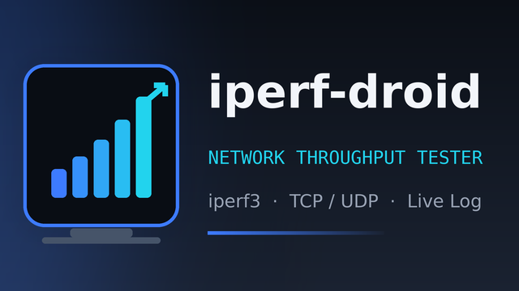

# iperf-droid

<center>



</center>

A graphical iperf3 tool for Android mobile and TV.

| Item       | Details                                  |
| ---------- | ---------------------------------------- |
| App name   | iperf-droid                              |
| Package    | `top.c8g.iperf_droid`                 |
| Minimum    | Android 5.0 (API 21)                     |
| Target     | Android 14 (API 34)                      |
| Stack      | Kotlin + AndroidX ConstraintLayout       |
| Repository | <https://github.com/gitsang/iperf-droid> |

## Features

- **Quick-command grid on the home screen**: one card per quick command, showing its name and the full command (`iperf3 -c 192.168.5.200`). Move focus with the d-pad, run with OK.
- **"Configure" entry in the top right**: opens the configuration screen to add, edit and delete quick commands.
- **Common argument templates**: the edit dialog offers built-in templates (TCP default, 10 seconds, JSON output, reverse, UDP 100M, this device as server) so you can fill them in with one tap instead of typing with the remote.
- **Live output**: the run screen scrolls iperf3's line-by-line output with timestamps, and "Stop" in the top right interrupts it. The live rate bar at the top refreshes on every interval.
- **Smart hints**: for common failures (cannot reach the server, port in use, permission denied, ...) the app shows a concrete troubleshooting suggestion.
- **Environment self-check**: one tap on the configuration screen verifies that iperf3 can execute; run it once after installing on the line.
- **Bundled iperf3 binaries**: `assets` ships statically compiled iperf3 (v3.9) for arm64-v8a / armeabi-v7a / x86_64 / x86. On first run it is unpacked into the app's private directory and executed, with **no root required**.
- **TV artwork**: `tv_banner` ships a landscape banner at five densities from 160×90 to 640×360; the launcher icon comes in square and round variants, and Android 8.0+ automatically uses the adaptive icon (separate foreground/background, theme-icon tinting supported).

## Usage

1. Open "iperf-droid" on the TV.
2. Top right "Configure" → "Add quick command" → enter a name (e.g. "Default server") and the arguments (e.g. `-c 192.168.5.200`) → OK.
3. Go back to the home screen and tap the card to start a test; the run screen shows output live.

### Arguments

The configuration holds iperf3 arguments (without the `iperf3` binary itself). Common ones:

| Argument           | Meaning                                                               |
| ------------------ | --------------------------------------------------------------------- |
| `-c 192.168.5.200` | Connect to the given server as a client (most common)                 |
| `-t 10`            | Run for 10 seconds                                                    |
| `-J`               | Emit JSON for programmatic parsing                                    |
| `-R`               | Reverse mode (server sends to the TV)                                 |
| `-u -b 100M`       | UDP mode capped at 100M                                               |
| `-s`               | Act as a server on this device (a separate machine drives the client) |
| `-p 5201`          | Use the given port                                                    |

## Building

Requires JDK 17 and the Android SDK (compileSdk 34, build-tools 34.0.0). The repo ships a
Gradle wrapper, so a separate Gradle install is not needed.

```bash
# Option 1: the bundled script (auto-detects JAVA_HOME / ANDROID_HOME)
./build.sh

# Option 2: by hand
export JAVA_HOME=/path/to/jdk-17
export ANDROID_HOME=/path/to/android-sdk
./gradlew assembleDebug      # artifact: app/build/outputs/apk/debug/app-debug.apk
```

Artifact: `app/build/outputs/apk/debug/app-debug.apk`; install it with `adb install -r`.

### Running unit tests

```bash
./gradlew testDebugUnitTest
```

The report is written to `app/build/reports/tests/testDebugUnitTest/index.html`.

## License

- [LICENSE](LICENSE)
- [THIRD_PARTY.md](THIRD_PARTY.md)
